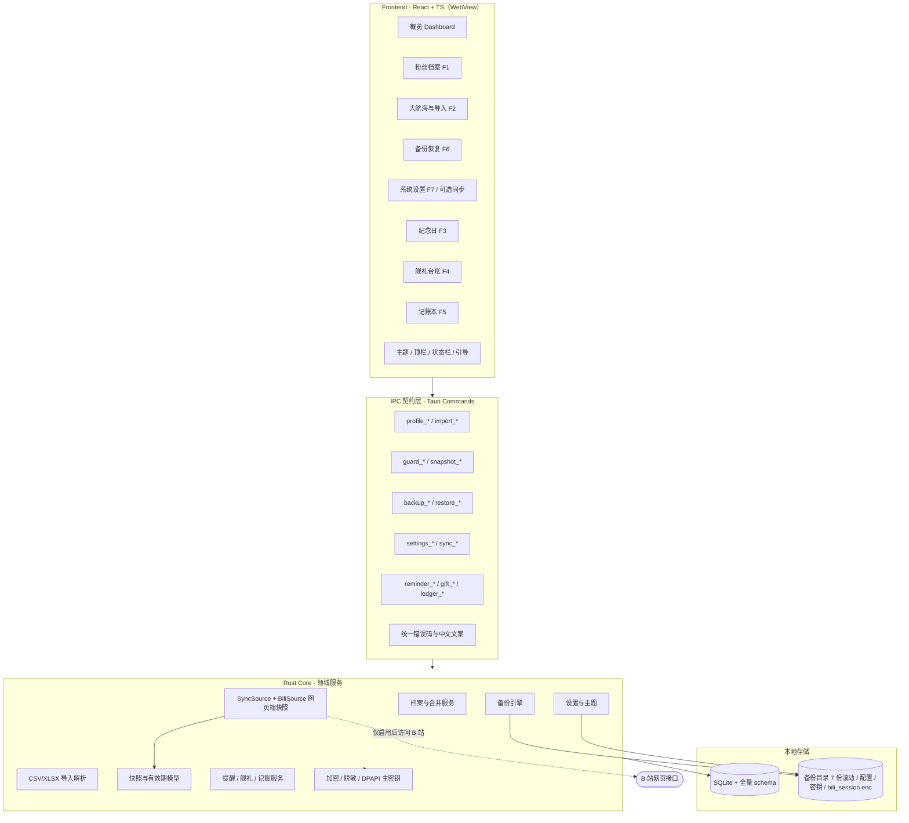

# 架构设计 · vtuber-fans-admin

> **权威需求来源**：[`../requirement-doc.md`](../requirement-doc.md)（v0.1 规划稿）。本文是实现层架构说明，不修改、不覆盖需求文档的既定决策。
> **版本管理**：源码推送至 `https://github.com/TankGH/vtuber-fans-admin.git`，`release/` 附带预构建产物；粉丝数据、主密钥与备份文件始终只保存在用户本机，不入库。

## 1. 定位与不可妥协的底线

面向 VTB 主播本人与助理的 **Windows 本地桌面工具**：粉丝终身档案、大航海名单、纪念日、舰礼、记账与备份。数据主权本地化是第一条底线——**没有云端后端**，任何档案、地址、生日、消费记录都不经过第三方服务器。

| 底线 | 架构约束 |
| --- | --- |
| 数据主权本地化 | 无云端 API、无遥测、无第三方统计；仅 SQLite 单文件 + 本地备份目录 |
| 同步「尽力而为」 | 同步源是可替换的 trait，失败可降级；手动导入是永不关闭的底座 |
| 普通用户「双击即用」 | 单 `.msi` / `.exe`，零 Python / Node 运行时；异常以中文文案直接展示 |

> **当前边界（v0.2.0）**：F1–F7 均为可用功能。同步引擎为**用户可选启用**的网页端低频快照：默认关闭，启用后按需扫码登录，凭证以 DPAPI 主密钥加密保存；已实现 HTTP 快照、WBI 签名、扫码登录与凭证管理，**未实现 WebSocket 实时事件订阅**。`SyncSource` trait 保留为后续扩展点。手动导入始终可用，同步失败时降级到手动通道。
>
> ⚠ **扫码自动获取尚未完成真实账号端到端验证，当前不建议使用**：接口可能变更或返回空名单并把当日快照写空。界面、启用确认框与部署文档均已强调；正式名单应走手动导入。

## 2. 技术选型

| 层 | 选型 | 依据 |
| --- | --- | --- |
| 桌面容器 | Tauri v2（Windows，MSI/EXE） | 需求文档 3.1；安装包约 3–15MB、RAM 10–30MB，面向 8GB 轻薄本 |
| 后端 | Rust stable `x86_64-pc-windows-msvc` | 加密、文件 IO、事务等稳定性逻辑放 Rust Core |
| 插件 | `tauri-plugin-dialog` / `notification` / `fs` / `log`，托盘用 Tauri v2 TrayIcon API | 原生目录选择、Toast、最小化到托盘 |
| 前端 | React 18 + TypeScript strict + Vite 5 + Tailwind CSS 3 + `@tauri-apps/api` v2 | 与 Tauri 模板一致；CSS 变量机制天然适配三套主题 |
| 存储 | `rusqlite`（bundled SQLite）+ 版本化 `schema.sql` | 单文件本地库，事务可靠 |
| 解析 | `csv`（流式）+ `calamine`（.xlsx，纯 Rust） | 无额外运行时依赖 |
| 基础库 | `serde` / `chrono` / `tracing` / `thiserror` / `aes-gcm` | 序列化、时间、日志、错误建模、字段加密 |
| 测试 | Rust `#[cfg(test)]` + Vitest | 合并规则、加解密、解析、滚动备份、IPC 文案映射 |

## 3. 分层架构

**四层切分**：`UI 层 → IPC 契约层 → 领域服务层 → 存储层`。所有跨语言交互收敛到 `src-tauri/src/commands.rs` 与 `src/lib/ipc.ts` 两处，避免 `invoke` 散落页面。Commands 只做参数校验与 DTO 转换，业务在领域服务内以事务完成。

**数据流**：用户操作 → `ipc.ts` 强类型 invoke → `commands.rs` 校验 → 领域服务（单事务）→ SQLite / 备份目录 → DTO → 页面更新。敏感字段在生成 DTO 前脱敏；完整地址单独由「二次确认命令」提供。

## 4. 安全与加密模型

### 4.1 需求文档目标 vs 当前实现（可审计偏差）

需求文档 3.3 指定 **SQLite + SQLCipher（AES-256）全库加密**。`rusqlite` 的 `bundled-sqlcipher-vendored-openssl` 在 Windows/MSVC 下需要 Perl、NASM 与 OpenSSL 源码编译链，在本机「无管理员权限 + 纯净 MSVC」环境下构建风险高。

> **当前采用降级方案，且不静默降低安全性**：
> 1. 数据库 = `rusqlite` bundled SQLite（常规单文件）；
> 2. **字段级 AES-256-GCM**：`address_encrypted` BLOB（收件人/电话/地址 JSON）、生日年份、B 站登录凭证（`bili_session.enc`）等敏感值密文落盘，每条记录独立随机 nonce；
> 3. 主密钥由 **Windows DPAPI**（`CryptProtectData`，CurrentUser 作用域）保护后存于本地 `app.key`，不以明文出现在磁盘或日志；
> 4. **备份文件整体加密**：`VACUUM INTO` 一致性快照后再做一次 AES-256-GCM 封装，`manifest.json` 记录校验摘要；
> 5. UI 默认脱敏：地址仅「省+市+区」、生日仅「月日」，年份可隐藏；导出完整地址需二次确认。

**仍然满足的底线**：敏感字段密文落盘、UI 默认脱敏、数据不出本机、备份可回退。
**未满足的部分**：数据库文件本身非整体加密（表名与昵称等非敏感列明文）。
**迁移回 SQLCipher 的路径**：见 [`ROADMAP.md`](./ROADMAP.md)「加密升级」；因加解密只集中在 `crypto.rs` 与 `db/mod.rs`，替换存储层不影响领域服务与 UI。

### 4.2 其它安全约束

- `tracing` 日志**禁止**写入 Cookie、收件人、电话、完整地址、生日与主密钥；只记录操作类型、行数、错误码。
- 导出完整地址必须先展示脱敏预览并二次确认；默认导出项是脱敏 CSV。
- 恢复前自动为当前库再备份一次，保证任何恢复都可回退。
- Tauri Capabilities 采用最小权限：仅 dialog / notification / fs（限定应用数据目录与备份目录）。网页端快照的网络请求由 Rust Core 的 `reqwest::blocking` 在后台线程发起，Web 视图不获得任意域的网络权限；二维码由 `qrcode` crate 在本机生成 SVG，不经第三方服务。
- **用户决定权**：`settings.json` 中 `syncEnabled` 默认 `false`。关闭时除本地状态读取外不发起任何外部请求；开启需前端二次确认，登录需用户主动点击扫码入口。凭证可随时通过「退出登录」清除。

## 5. 模块职责

| 模块 | 职责 | 关键约束 |
| --- | --- | --- |
| `error.rs` | 唯一错误源：错误码 + 人类可读中文文案 | 前端不再自行拼装错误描述 |
| `crypto.rs` | AES-256-GCM、DPAPI 主密钥、脱敏、备份封装 | 所有敏感值出入口 |
| `db/mod.rs` | 连接、迁移、事务、`VACUUM INTO` | 写操作全部事务化 |
| `profile.rs` | F1 CRUD、昵称历史、手动锁定合并状态机、大航海状态汇总 | 同 UID 保留最早首次互动时间；`guard_state_map` 区分当前等级 / 最后等级 / 已过期 |
| `import.rs` | F2 CSV/xlsx 解析、字段映射、预览、批量写入 | 预览不写库；确认后单事务 O(n) |
| `guard.rs` | 快照/成员/事件查询与有效期核算 | 纯数据层，无网络 |
| `sync/mod.rs` | `SyncSource` trait、凭证加密存取、扫码会话、快照合并、每日调度 | 只在 `syncEnabled=true` 时访问网络；同日重复同步覆盖同一快照 |
| `sync/bilibili.rs` | 扫码登录、WBI 签名、大航海名单解析 | 纯同步函数，只在 `spawn_blocking` / 后台线程调用，不阻塞 UI |
| `reminder.rs` / `gifts.rs` / `ledger.rs` | F3 / F4 / F5 领域服务 | 生日脱敏、完整地址二次确认、事件归集幂等；`reminder.rs` 另按上舰起算日生成 N 天 / N 周年里程碑，并管理 `custom_reminder` 表（动态类型 `guard_days_*` / `guard_years_*` / `custom_*`） |
| `backup.rs` | 启动备份、7 份滚动、manifest、恢复标记、导出 | 恢复走重启替换，避免文件占用 |
| `settings.rs` | 主题、备份目录、托盘行为、同步开关与提醒配置 | 开启同步只由 `sync_set_enabled` 写入且需二次确认 |
| `commands.rs` | 全部 IPC 命令注册 | 唯一跨语言边界 |

## 6. 后台任务与 Windows 集成

- **启动序列**：读设置 → 检查 `restore.json` 恢复标记 → 打开数据库（执行迁移）→ 注册 `SyncState` → 后台异步执行启动备份与滚动清理、启动定时同步线程 → 构建窗口、托盘、状态栏 → 前端初始化主题与首启引导。
- **每日调度**：后台线程每 5 分钟检查一次本地配置；仅在用户启用同步、当前小时等于设定快照时刻、当天尚未尝试且当天尚无同步快照时执行一次。失败记录到界面状态，不重试轰炸。
- **托盘**：关闭主窗口按设置「最小化到托盘」或「退出应用」；托盘菜单含显示主窗口、立即备份、退出。
- **通知**：`tauri-plugin-notification` 发 Windows 原生 Toast，用于每日首次启动的纪念日汇总（`reminder_notify`，由 `app_meta` 日期标记去重）。
- **首启引导**：保持「选择备份目录 → 完成」两步，不强制登录；说明自动抓取默认关闭，需要时到设置中主动开启并扫码。
- **诊断**：界面直接显示「文件格式错误 / 备份目录不可写 / 数据库被占用」等原因与「重试」按钮，不要求用户查看日志。

## 7. 性能与复杂度

- 导入为 O(n) 单事务；CSV 流式读取、xlsx 按 sheet 迭代，不整表驻留内存。
- 档案列表分页 + 索引查询，避免全表扫描与 IPC 大 payload。
- 前端主题切换仅改根元素 `data-theme` 的 CSS 变量，不触发整树重渲染。
- 备份在启动后台任务执行，不阻塞首屏；`VACUUM INTO` 保证快照一致性。
- 瓶颈在 xlsx 大文件解析与备份 IO，采用「预览阶段限量展示 + 确认后批量写入」规避卡顿。

## 8. 打包与构建链路

- `tauri.conf.json`：窗口 1440×900（最小 1024×680）、托盘图标、`bundle.targets` 为 `["nsis"]`（WiX 3 代码页 1252 不支持中文产品名，故不打 MSI）、前端 `devUrl` / `frontendDist` 指向 Vite。
- 构建：`npm run build` → `npm run tauri build`；Rust 侧 `cargo check` / `cargo test`。
- **工具链前置**：rustup stable `x86_64-pc-windows-msvc` + VS Build Tools 2022（C++ 生成工具 + Windows SDK）+ 系统自带 WebView2 运行时。
- **降级路径**：若本机 MSVC/原生依赖安装受阻，保留完整源码与文档，用 `npm run dev`（Vite + dev 演示数据适配器）验证全部 UI，并在 `README.md` 明确区分「前端已验证」与「Tauri 原生端待验证」，**不伪造编译通过**。

## 9. 当前未做

- 直播间 **WebSocket 实时事件订阅**（L2）：当前只做网页端低频名单快照，购买 / 续费事件仍来自手动导入。
- 快照 diff 推断续费事件、按事件自动核算有效期的完整闭环。
- 跨 Windows 用户的主密钥迁移工具、SQLCipher 全库加密。
- 真实 B 站账号的扫码登录与名单拉取人工端到端验证（需要账号与网络环境）。

演进步骤见 [`ROADMAP.md`](./ROADMAP.md)。
